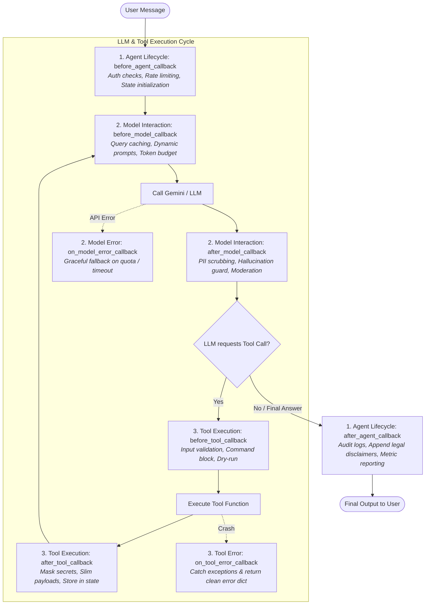
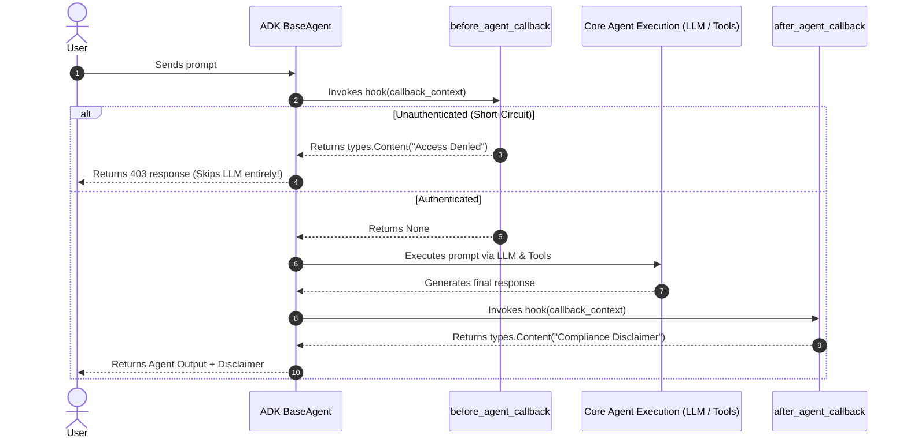
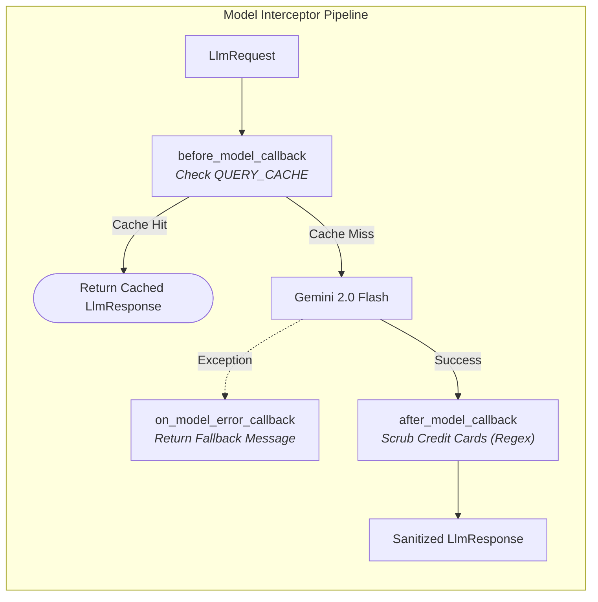
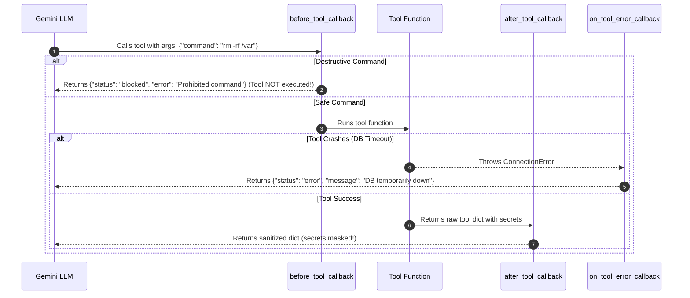

# Mastering Google ADK Callbacks: The Deterministic Control Plane for AI Agents

*A deep-dive, hands-on guide to Google Agent Development Kit (ADK) Callbacks - learning by building robust, production-ready systems*

📁 **Code Examples**: [GitHub Repository](https://github.com/pranavdhopey/ADK-Agent-Basics.git) (Inside [`callback_agent/`](callback_agent/))  
📖 **Official Specification**: [Google ADK Callbacks (adk.dev/callbacks)](https://adk.dev/callbacks/)

---

Hey there, fellow learner!

If you've been following our journey with the Google Agent Development Kit (ADK), we've tackled some incredible milestones: building personality-driven greeting bots, giving agents internet search, structuring JSON with Pydantic, managing stateful memory, orchestrating sequential and parallel agent teams, and even plugging into remote MCP servers.

Everything looks magical when you run a demo in a notebook or web UI. But the second you start thinking about shipping an AI agent to **production**, a wave of cold reality hits:

- *What happens when an unauthenticated user sends a request to my expensive model?*
- *How do I stop paying for duplicate API calls when 100 users ask the exact same FAQ question?*
- *What if the LLM hallucinates and decides to call a shell tool with `rm -rf /` or `DROP TABLE`?*
- *What if a database or third-party API tool crashes mid-run? Does the whole agent crash with a 500 error?*
- *How do I ensure internal API keys and sensitive customer PII never leak into prompt histories?*

If your answer is: *"I'll just tell the LLM in the `instruction` prompt not to do that..."* — **STOP!** 🛑

Instructions are probabilistic guidelines. They are soft hints. Production systems need **hard, deterministic, code-level guarantees**.

In Google ADK, that deterministic control plane is built into **Callbacks**.

This blog series breaks down the complete ADK Callbacks architecture across **4 practical parts**, walking from foundational concepts to advanced interception patterns with runnable code you can test and experiment with immediately.

---

## Table of Contents

- [The Big Picture: What Are ADK Callbacks?](#the-big-picture-what-are-adk-callbacks)
- [Part 1: Agent Lifecycle Callbacks - The Security Gatekeepers](#part-1-agent-lifecycle-callbacks---the-security-gatekeepers)
  - `before_agent_callback` & `after_agent_callback`
  - Hands-on: Building the `auth_guard_agent`
  - Understanding `CallbackContext` and Short-Circuiting
- [Part 2: Model Interaction Callbacks - Peeking Inside the Brain](#part-2-model-interaction-callbacks---peeking-inside-the-brain)
  - `before_model_callback`, `after_model_callback` & `on_model_error_callback`
  - Understanding `LlmRequest` and `LlmResponse`
  - Hands-on: Building the `smart_cache_guard_agent`
- [Part 3: Tool Execution Callbacks - The Safety Valve for Real Actions](#part-3-tool-execution-callbacks---the-safety-valve-for-real-actions)
  - `before_tool_callback`, `after_tool_callback` & `on_tool_error_callback`
  - Guardrails, Dry-runs, and the "Store-and-Slim" Pattern
  - Hands-on: Building the `safe_devops_tool_agent`
- [Part 4: The Enterprise Pipeline - Chaining, Precedence & Full Blueprint](#part-4-the-enterprise-pipeline---chaining-precedence--full-blueprint)
  - Callback Chaining and List Execution Order
  - Decision Matrix: Callbacks vs Instructions vs Tools vs State
  - The #1 Gotcha: Exact Parameter Naming
- [Quick Reference Card: ADK Callbacks Cheat Sheet](#quick-reference-card-adk-callbacks-cheat-sheet)

---

# The Big Picture: What Are ADK Callbacks?

According to the official [ADK Documentation](https://adk.dev/callbacks/), **callbacks** are user-defined functions that hook into an agent's execution pipeline at predefined checkpoints.

Instead of being passive logging listeners, ADK callbacks act as an **active intervention plane**. They give you programmatic hooks across three distinct architectural boundaries:



### The Two Core Modes: Pass vs. Override

Every callback in ADK operates under a simple, elegant contract:

1. **Pass / Observe Mode (`return None`)**:  
   If your callback function returns `None`, ADK considers your inspection complete and continues standard execution down the pipeline.
2. **Override / Short-Circuit Mode (`return Object`)**:  
   If your callback returns a non-`None` value (such as a `types.Content`, an `LlmResponse`, or a dictionary), ADK **skips the subsequent native step entirely** and substitutes your returned value!

Now that we see the map, let's explore each level step by step.

---

# Part 1: Agent Lifecycle Callbacks - The Security Gatekeepers

📁 **Code**: [callback_agent/agent.py](callback_agent/agent.py)  
> **TL;DR**: Learn how to intercept requests before any agent logic executes using `before_agent_callback` and append compliance notices using `after_agent_callback`. Master `CallbackContext` and early short-circuiting.

---

## The Scenario

Imagine you are deploying an internal Banking and HR Copilot. Every call to the Gemini model incurs costs and accesses confidential employee data. 

You need two guarantees:
1. **The Bouncer**: If a user is not authenticated or their session has expired, the agent should **immediately reject them** without ever touching the LLM or calling database tools.
2. **The Compliance Auditor**: When an authenticated user finishes a query, an automated legal disclaimer and audit trail must be appended to the transcript.

Let's build this using **Agent Lifecycle Callbacks**.

## How Agent Callbacks Work

Agent lifecycle callbacks are available on **any** ADK agent inheriting from `BaseAgent`—including `Agent`, `SequentialAgent`, `ParallelAgent`, and `LoopAgent`.

They execute at the absolute perimeter of the agent:
- `before_agent_callback(callback_context)`: Invoked first. Can read or update `callback_context.state`, check `callback_context.user_content`, and return `types.Content` to short-circuit.
- `after_agent_callback(callback_context)`: Invoked last. Can read the final state and return `types.Content` to append an additional response event.



## The Code: Building `auth_guard_agent`

Here is how we write the callbacks in Python:

```python
from typing import Optional
from google.adk.agents import Agent
from google.adk.agents.callback_context import CallbackContext
from google.genai import types

def verify_session_auth(callback_context: CallbackContext) -> Optional[types.Content]:
    """
    Agent Lifecycle: before_agent_callback
    Runs before any agent logic or model calls.
    """
    # 1. Read authentication state from session
    is_authenticated = callback_context.state.get("authenticated", False)
    user_id = callback_context.user_id or "anonymous"
    
    print(f"🔒 [before_agent] Checking session for user '{user_id}' (authenticated={is_authenticated})")
    
    # 2. If unauthorized, SHORT-CIRCUIT the entire agent run!
    if not is_authenticated:
        return types.Content(
            parts=[
                types.Part.from_text(
                    text="⛔ [Access Denied] Your session is unauthenticated. Please log in first."
                )
            ]
        )
    
    # 3. Returning None tells ADK: 'All good, proceed normally!'
    return None


def append_audit_notice(callback_context: CallbackContext) -> Optional[types.Content]:
    """
    Agent Lifecycle: after_agent_callback
    Runs after the agent produces its final result.
    """
    print("📋 [after_agent] Appending compliance notice...")
    return types.Content(
        parts=[
            types.Part.from_text(
                text="\n\n---\n*🔒 Audit Notice: This response was generated under ISO-27001 data compliance.*"
            )
        ]
    )


# Attach directly to the Agent definition:
auth_guard_agent = Agent(
    name="auth_guard_agent",
    model="gemini-2.0-flash",
    description="A secure agent guarded by lifecycle callbacks",
    instruction="You are a helpful banking assistant. Answer questions politely.",
    before_agent_callback=verify_session_auth,
    after_agent_callback=append_audit_notice,
)
```

## Parameter & Control Flow Breakdown

| Callback Field | Python Signature | When Does It Run? | Return Value Effect |
| :--- | :--- | :--- | :--- |
| `before_agent_callback` | `(callback_context: CallbackContext)` | First step when agent receives a message | • `None`: Proceed to agent execution.<br>• `types.Content`: **Short-circuit!** Skips agent and model execution completely, returning this content immediately to user. |
| `after_agent_callback` | `(callback_context: CallbackContext)` | After agent completes its work | • `None`: Keep original output.<br>• `types.Content`: Appends an extra event with this content to conversation history. |

### What I Learned in Part 1
- **Short-circuiting saves real money**: When an unauthorized user sends a prompt, returning `types.Content` prevents any call to the Gemini API. Zero token charges!
- **State access is seamless**: Through `callback_context.state`, you can read session variables, increment interaction counters, or set feature flags before the agent starts.

---

# Part 2: Model Interaction Callbacks - Peeking Inside the Brain

📁 **Code**: [callback_agent/agent.py](callback_agent/agent.py)  
> **TL;DR**: Intercept what goes *into* and comes *out of* the LLM using `before_model_callback`, `after_model_callback`, and `on_model_error_callback`. Implement semantic response caching and automated PII scrubbing.

---

## The Scenario

Now that our agent only talks to authenticated users, we notice two major operational headaches:
1. **Repetitive FAQ queries**: 40% of users ask identical questions like *"What are your support hours?"* or *"What is your return policy?"*. Paying Gemini tokens for identical questions every hour is wasteful.
2. **PII Leakage Risk**: Even with strict prompts, the model might accidentally quote or output sensitive numbers (e.g. credit card strings or SSNs) in conversation turns.
3. **API Resilience**: If Google's API or network experiences a transient rate-limit (HTTP 429), the user shouldn't see a raw Python traceback.

Enter **Model Interaction Callbacks**.

## How Model Callbacks Work

Model callbacks are available on `LlmAgent` and trigger directly around the LLM API boundary:
- `before_model_callback(callback_context, llm_request)`: Runs right before the payload is dispatched to Gemini. You can inspect or modify `llm_request`. If you return an `LlmResponse`, the LLM call is **skipped** (caching pattern!).
- `after_model_callback(callback_context, llm_response)`: Runs right after receiving Gemini's response. You can inspect token usage, modify generated text, or scrub PII.
- `on_model_error_callback(callback_context, llm_request, error)`: Catches model generation exceptions and returns a fallback `LlmResponse`.



## The Code: Building `smart_cache_guard_agent`

```python
import re
from typing import Dict, Optional
from google.adk.agents import Agent
from google.adk.agents.callback_context import CallbackContext
from google.adk.models.llm_request import LlmRequest
from google.adk.models.llm_response import LlmResponse
from google.genai import types

# 1. Simple in-memory response cache
RESPONSE_CACHE: Dict[str, str] = {
    "what are your support hours?": "Our support center is open 24/7 at 1-800-555-0199.",
    "what is your refund policy?": "You can request a full refund within 30 days of purchase.",
}

def query_cache_guard(
    callback_context: CallbackContext, 
    llm_request: LlmRequest
) -> Optional[LlmResponse]:
    """
    Model Interaction: before_model_callback
    Runs right before calling Gemini.
    """
    user_query = ""
    if callback_context.user_content and callback_context.user_content.parts:
        user_query = callback_context.user_content.parts[0].text or ""
    
    clean_query = user_query.strip().lower()
    print(f"🧠 [before_model] Checking query cache for: '{clean_query}'")
    
    # Cache Hit: Return an LlmResponse directly to SKIP the API call!
    if clean_query in RESPONSE_CACHE:
        cached_answer = RESPONSE_CACHE[clean_query]
        print("⚡ [Cache Hit] Skipping LLM call and returning cached response!")
        return LlmResponse(
            content=types.Content(
                role="model",
                parts=[types.Part.from_text(text=f"[⚡ Cached] {cached_answer}")]
            )
        )
    
    # Cache Miss: Return None to continue to Gemini
    return None


def pii_redactor_guard(
    callback_context: CallbackContext, 
    llm_response: LlmResponse
) -> Optional[LlmResponse]:
    """
    Model Interaction: after_model_callback
    Runs right after Gemini responds, before tools or users see it.
    """
    print("🛡️ [after_model] Scanning model response for credit card patterns...")
    if not llm_response.content or not llm_response.content.parts:
        return None
    
    cc_regex = re.compile(r"\b(?:\d{4}[-\s]?){3}\d{4}\b")
    modified = False
    new_parts = []
    
    for part in llm_response.content.parts:
        if part.text and cc_regex.search(part.text):
            print("🚨 [PII Redaction] Found credit card number! Redacting...")
            sanitized = cc_regex.sub("[REDACTED CARD]", part.text)
            new_parts.append(types.Part.from_text(text=sanitized))
            modified = True
        else:
            new_parts.append(part)
            
    if modified:
        # Returning a new LlmResponse replaces the model output!
        return LlmResponse(content=types.Content(role="model", parts=new_parts))
    
    return None


def model_error_recovery(
    callback_context: CallbackContext, 
    llm_request: LlmRequest, 
    error: Exception
) -> Optional[LlmResponse]:
    """
    Model Interaction: on_model_error_callback
    Catches timeouts, quota blocks, or rate limits.
    """
    print(f"⚠️ [on_model_error] LLM error intercepted: {error}")
    return LlmResponse(
        content=types.Content(
            role="model",
            parts=[types.Part.from_text(text="Our servers are under heavy load. Please try again in 30 seconds.")]
        )
    )

cache_agent = Agent(
    name="smart_cache_guard_agent",
    model="gemini-2.0-flash",
    instruction="You are a helpful customer support assistant.",
    before_model_callback=query_cache_guard,
    after_model_callback=pii_redactor_guard,
    on_model_error_callback=model_error_recovery,
)
```

## Parameter & Control Flow Breakdown

| Callback Field | Python Signature | When Does It Run? | Return Value Effect |
| :--- | :--- | :--- | :--- |
| `before_model_callback` | `(callback_context: CallbackContext, llm_request: LlmRequest)` | Right before sending prompt to Gemini | • `None`: Sends request to LLM.<br>• `LlmResponse`: **Skips the LLM call entirely!** Returns this response. |
| `after_model_callback` | `(callback_context: CallbackContext, llm_response: LlmResponse)` | Immediately after receiving model response | • `None`: Leaves model response intact.<br>• `LlmResponse`: **Overrides** the model response seen downstream. |
| `on_model_error_callback` | `(callback_context: CallbackContext, llm_request: LlmRequest, error: Exception)` | When LLM API call fails | • `None`: Re-raises exception.<br>• `LlmResponse`: Suppresses exception and provides fallback message. |

---

# Part 3: Tool Execution Callbacks - The Safety Valve for Real Actions

📁 **Code**: [callback_agent/agent.py](callback_agent/agent.py)  
> **TL;DR**: Intercept tool invocations using `before_tool_callback`, `after_tool_callback`, and `on_tool_error_callback`. Implement destructive command blocking, credential masking, and the high-efficiency "Store-and-Slim" pattern.

---

## The Scenario

Now things get serious. In Parts 5 & 6 of our main series, we gave our agents `FunctionTool` and `AgentTool` to run actual Python code and bash commands.

Now imagine our agent has an `execute_server_command` tool. What if the user types:
> *"Clean up temporary files in /var/log by running rm -rf /var/log"*

Or what if a database tool returns sensitive internal keys (`internal_api_secret`, `db_password`) that the LLM might hallucinate back to the user?

We need a code-level **Safety Valve**.

## How Tool Callbacks Work

Tool execution callbacks wrap every tool call requested by the LLM:
- `before_tool_callback(tool, args, tool_context)`: Inspects arguments before execution. Can sanitize inputs or block dangerous commands by returning a dictionary (skipping tool execution!).
- `after_tool_callback(tool, args, tool_context, tool_response)`: Inspects raw tool output. Can scrub passwords, mask tokens, or implement **Store-and-Slim** (saving heavy payloads to state and passing only a summary to the LLM to save tokens).
- `on_tool_error_callback(tool, args, tool_context, error)`: Catches tool exceptions (e.g., database timeout) and returns a clean error dict instead of crashing.



## The Code: Building `safe_devops_tool_agent`

```python
from typing import Any, Dict, Optional
from google.adk.agents import Agent
from google.adk.tools import BaseTool, ToolContext

# Example Tools
def execute_server_command(command: str) -> Dict[str, Any]:
    """Executes a system shell command."""
    return {"status": "success", "stdout": f"Executed command: '{command}'"}

def lookup_customer_account(account_id: str) -> Dict[str, Any]:
    """Fetches customer record from database."""
    if account_id == "corrupt_acc":
        raise ConnectionError("Database cluster unreachable")
    return {
        "account_id": account_id,
        "name": "Alice Johnson",
        "balance": 14250.75,
        "internal_api_secret": "sk_live_9876543210abcdef",
    }


def command_guard_callback(
    tool: BaseTool, 
    args: Dict[str, Any], 
    tool_context: ToolContext
) -> Optional[Dict[str, Any]]:
    """
    Tool Execution: before_tool_callback
    Runs BEFORE any tool executes.
    """
    print(f"🛠️ [before_tool] Checking tool '{tool.name}' with args: {args}")
    
    if tool.name == "execute_server_command":
        cmd = args.get("command", "").lower()
        blocked_keywords = ["rm -rf", "drop table", "mkfs", "delete from"]
        for bad_pattern in blocked_keywords:
            if bad_pattern in cmd:
                print(f"🛑 [Tool Guard Blocked] Found prohibited keyword: '{bad_pattern}'")
                # Returning a dict SKIPS tool execution and returns this result to LLM!
                return {
                    "status": "blocked",
                    "error": f"Security Policy Violation: Command contains '{bad_pattern}'. Execution blocked."
                }
                
    return None


def secret_scrubber_and_slimmer(
    tool: BaseTool, 
    args: Dict[str, Any], 
    tool_context: ToolContext, 
    tool_response: Dict[str, Any]
) -> Optional[Dict[str, Any]]:
    """
    Tool Execution: after_tool_callback
    Runs AFTER tool returns, before result is sent to LLM.
    """
    print(f"🧼 [after_tool] Scrubbing tool '{tool.name}' response...")
    if isinstance(tool_response, dict):
        sanitized = dict(tool_response)
        
        # 1. Mask internal secrets
        if "internal_api_secret" in sanitized:
            sanitized["internal_api_secret"] = "[REDACTED_SECRET]"
            
        # 2. Store-and-Slim Pattern: Save heavy data to session state!
        if "name" in sanitized:
            tool_context.state["last_customer_name"] = sanitized["name"]
            
        return sanitized
        
    return None


def tool_error_recovery(
    tool: BaseTool, 
    args: Dict[str, Any], 
    tool_context: ToolContext, 
    error: Exception
) -> Optional[Dict[str, Any]]:
    """
    Tool Execution: on_tool_error_callback
    Runs when a tool throws an unhandled exception.
    """
    print(f"🩹 [on_tool_error] Tool '{tool.name}' threw exception: {error}")
    # Return structured error dict so LLM can explain problem smoothly
    return {
        "status": "error",
        "message": f"Service '{tool.name}' is temporarily unavailable. Please retry in a moment."
    }

devops_agent = Agent(
    name="safe_devops_tool_agent",
    model="gemini-2.0-flash",
    instruction="You are a safe DevOps assistant. Use tools to inspect accounts and run commands.",
    tools=[execute_server_command, lookup_customer_account],
    before_tool_callback=command_guard_callback,
    after_tool_callback=secret_scrubber_and_slimmer,
    on_tool_error_callback=tool_error_recovery,
)
```

## Parameter & Control Flow Breakdown

| Callback Field | Python Signature | When Does It Run? | Return Value Effect |
| :--- | :--- | :--- | :--- |
| `before_tool_callback` | `(tool: BaseTool, args: dict, tool_context: ToolContext)` | Before tool function executes | • `None`: Tool executes normally.<br>• `dict`: **Skips tool execution!** Returns this dictionary directly as the tool result. |
| `after_tool_callback` | `(tool: BaseTool, args: dict, tool_context: ToolContext, tool_response: dict)` | Immediately after tool finishes | • `None`: Preserves original tool result.<br>• `dict`: **Overrides** the tool result received by the LLM. |
| `on_tool_error_callback` | `(tool: BaseTool, args: dict, tool_context: ToolContext, error: Exception)` | When a tool raises an unhandled exception | • `None`: Re-raises exception.<br>• `dict`: Suppresses exception and provides structured error result. |

---

# Part 4: The Enterprise Pipeline - Chaining, Precedence & Full Blueprint

📁 **Code**: [callback_agent/agent.py](callback_agent/agent.py)  
> **TL;DR**: Combine Agent, Model, and Tool callbacks into a single cohesive pipeline. Learn how to chain multiple callback functions in lists, understand execution precedence, and avoid the #1 Python gotcha.

---

## 1. Callback Chaining with Lists

Did you know that every callback argument in ADK accepts either a **single callable** or a **list of callables**?

```python
root_agent = Agent(
    name="audited_agent",
    model="gemini-2.0-flash",
    # Multiple callbacks chained in order:
    before_tool_callback=[
        log_tool_invocation_metrics,
        validate_user_permissions,
        block_destructive_commands,
    ]
)
```

### How ADK Resolves Callback Chains
ADK executes callbacks in the exact order they appear in the list until **one callback returns a non-None value**:
1. `log_tool_invocation_metrics` runs -> returns `None` (passes through).
2. `validate_user_permissions` runs -> returns `None` (passes through).
3. `block_destructive_commands` runs -> returns `{"status": "blocked"}`!
4. **Execution stops here**: Remaining callbacks and the tool execution are skipped!

---

## 2. When to Use What: The Decision Matrix

One of the biggest questions developers ask is: *"Should I solve this with an instruction, a tool, state, or a callback?"*

Use this cheat sheet to choose the right tool for the job:

| Capability / Requirement | Instructions | State | Tools | Callbacks |
| :--- | :---: | :---: | :---: | :---: |
| Agent tone, personality & role | ✅ **Best** | ❌ No | ❌ No | ❌ No |
| Retaining user details across turns | ❌ No | ✅ **Best** | ❌ No | ⚠️ Can read/set |
| Fetching external data / taking actions | ❌ No | ❌ No | ✅ **Best** | ❌ No |
| **Deterministic Access Control (Auth)** | ❌ Fragile | ❌ No | ❌ No | ✅ **Best** (`before_agent`) |
| **Response Caching (Zero Token Cost)** | ❌ Impossible | ❌ No | ❌ No | ✅ **Best** (`before_model`) |
| **PII & Secret Redaction** | ❌ Unreliable | ❌ No | ❌ No | ✅ **Best** (`after_model` / `after_tool`) |
| **Blocking Destructive Commands** | ❌ Unreliable | ❌ No | ❌ No | ✅ **Best** (`before_tool`) |
| **Graceful API / Tool Crash Recovery** | ❌ Impossible | ❌ No | ❌ No | ✅ **Best** (`on_*_error`) |

---

## 3. The #1 Gotcha: Exact Parameter Naming

According to [adk.dev/callbacks](https://adk.dev/callbacks/), ADK invokes Python callbacks using **keyword arguments (`**kwargs`)**.

If you name your parameters using personal aliases like `ctx`, your code will fail with an immediate runtime crash:

```python
# ❌ THIS WILL CRASH AT RUNTIME!
def my_callback(ctx):  # TypeError: got an unexpected keyword argument 'callback_context'
    return None

# ✅ THIS WORKS PERFECTLY!
def my_callback(callback_context):
    return None
```

### The Golden Naming Rules:
- **Agent Callbacks**: Must use `callback_context`
- **Model Callbacks**: Must use `callback_context`, `llm_request`, `llm_response`, `error`
- **Tool Callbacks**: Must use `tool`, `args`, `tool_context`, `tool_response`, `error`

---

## 4. Async Support

All callbacks in ADK support both standard synchronous (`def`) and asynchronous (`async def`) functions:

```python
async def async_auth_guard(callback_context: CallbackContext) -> Optional[types.Content]:
    # Seamlessly call remote Redis or Auth0 services!
    user_token = callback_context.state.get("token")
    is_valid = await verify_jwt_with_auth0(user_token)
    if not is_valid:
        return types.Content(parts=[types.Part.from_text(text="Invalid token.")])
    return None
```

ADK automatically detects if a callback returns an `Awaitable` and awaits it seamlessly.

---

# Quick Reference Card: ADK Callbacks Cheat Sheet

Keep this table handy when developing agents with Google ADK:

```
┌────────────────────────────────────────────────────────────────────────────────────────┐
│                              GOOGLE ADK CALLBACKS MATRIX                              │
├────────────────────────┬──────────────────────────────────┬────────────────────────────┤
│ Hook Name              │ Exact Required Parameter Names   │ Return Type to Override   │
├────────────────────────┼──────────────────────────────────┼────────────────────────────┤
│ before_agent_callback  │ callback_context                 │ Optional[types.Content]    │
│ after_agent_callback   │ callback_context                 │ Optional[types.Content]    │
├────────────────────────┼──────────────────────────────────┼────────────────────────────┤
│ before_model_callback  │ callback_context, llm_request    │ Optional[LlmResponse]      │
│ after_model_callback   │ callback_context, llm_response   │ Optional[LlmResponse]      │
│ on_model_error_callback│ callback_context, llm_request,   │ Optional[LlmResponse]      │
│                        │ error                            │                            │
├────────────────────────┼──────────────────────────────────┼────────────────────────────┤
│ before_tool_callback   │ tool, args, tool_context         │ Optional[dict]             │
│ after_tool_callback    │ tool, args, tool_context,        │ Optional[dict]             │
│                        │ tool_response                    │                            │
│ on_tool_error_callback │ tool, args, tool_context, error  │ Optional[dict]             │
└────────────────────────┴──────────────────────────────────┴────────────────────────────┘
```

---

## 🎮 Hands-on Practice: Run the Demo Agent!

You can test every single concept explained in this blog right now in your terminal:

```bash
cd callback_agent
python run_agent.py
```

Try these interactive tests:
1. Type `login` / `logout` to watch `before_agent_callback` block or permit access.
2. Type `hours` to see `before_model_callback` return an instant zero-token cache hit.
3. Type `danger` to watch `before_tool_callback` block a `rm -rf` command.
4. Type `account` to watch `after_tool_callback` scrub database passwords.
5. Type `crash` to watch `on_tool_error_callback` recover smoothly from a database outage.

Happy building, and may your agents run securely and reliably in production! 🚀

