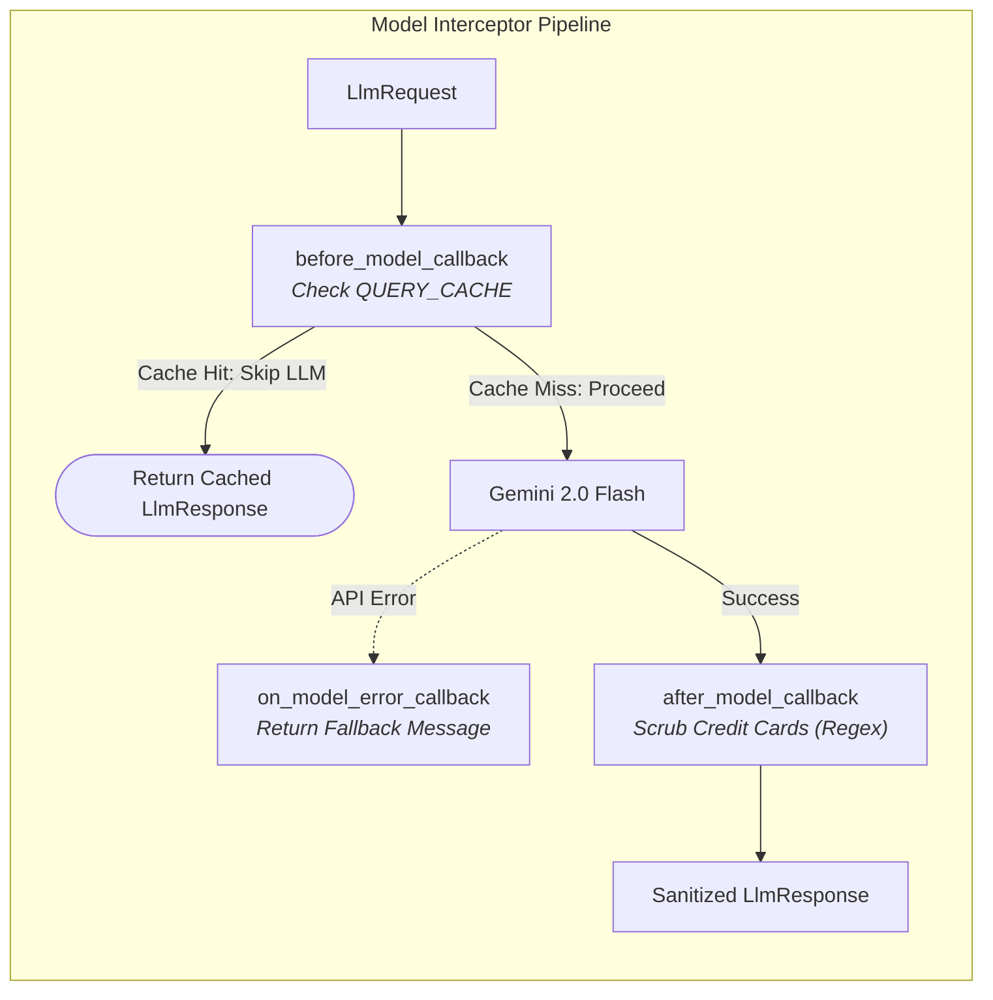

> 📁 **Source Code**: [`callback_agent/`](../callback_agent/)  
> 📖 **Callbacks Master Series**: [Blog Directory](README.md)  
> 🌐 **Official Spec**: [adk.dev/callbacks](https://adk.dev/callbacks/)

---

# Part 2: Model Interaction Callbacks - Peeking Inside the Brain

📁 **Code**: [callback_agent/agent.py](../callback_agent/agent.py)  
> **TL;DR**: Intercept what goes *into* and comes *out of* the LLM using `before_model_callback`, `after_model_callback`, and `on_model_error_callback`. Implement zero-cost response caching, regex PII redaction, and graceful API outage recovery.

*Welcome back to the Callbacks series! If you're joining fresh, check out [Part 1](callbacks-part-1-agent-lifecycle.md) where we built an authentication gatekeeper at the agent perimeter.*

---

## Reflections on Part 1

In Part 1, we learned that instructions alone can't protect our agent from unauthorized access. By adding `before_agent_callback`, we put a deterministic "bouncer" at the front door that short-circuits unauthorized requests before Gemini is ever invoked.

Our front door is secure. But once authenticated users get inside, two new operational headaches immediately appear...

---

## What We're Building in Part 2

Have you noticed how users interact with support bots?
- **Repetitive FAQ Questions**: 40% of users ask the exact same questions: *"What are your support hours?"* or *"What is your refund policy?"*. Paying Gemini tokens for the exact same static answer every minute is like setting your API budget on fire.
- **Accidental PII Leakage**: Even with strict instructions, models can quote or generate sensitive numbers like credit card numbers or SSNs in the chat history.
- **API Outages**: If the model API experiences a temporary rate limit (HTTP 429) or timeout, the user shouldn't see a raw Python crash.

In this part, we fix all three using **Model Interaction Callbacks**:
- `before_model_callback` - Caching answers to skip the LLM call entirely
- `after_model_callback` - Inspecting and redacting sensitive PII before display
- `on_model_error_callback` - Catching API exceptions gracefully

Let's dive in!

---

## How Model Callbacks Work

Model callbacks are available on `LlmAgent` and trigger directly around the LLM API boundary:



### The Key Contracts:
1. `before_model_callback(callback_context, llm_request)`:
   - Returning `None` sends the request to Gemini normally.
   - Returning an `LlmResponse` **skips the LLM call entirely** (Response Caching / Cost Saving!).
2. `after_model_callback(callback_context, llm_response)`:
   - Returning `None` keeps the model's response unmodified.
   - Returning a new `LlmResponse` **replaces** what the downstream pipeline and user see.
3. `on_model_error_callback(callback_context, llm_request, error)`:
   - Returning an `LlmResponse` suppresses the exception and provides a friendly message.

---

## Enter: The Smart Cache Guard Agent

### The Scenario

We want an agent that:
1. **Checks a local FAQ cache**: If the user asks *"What are your support hours?"*, return the answer instantly with **zero API cost and zero latency**.
2. **Redacts credit card numbers**: If Gemini outputs a 16-digit credit card pattern, scrub it to `[REDACTED CARD NUMBER]`.
3. **Recovers from outages**: If the API rate-limits us, return a friendly message instead of crashing.

### The Code

```python
import re
from typing import Dict, Optional
from google.adk.agents import Agent
from google.adk.agents.callback_context import CallbackContext
from google.adk.models.llm_request import LlmRequest
from google.adk.models.llm_response import LlmResponse
from google.genai import types

# 1. Simple in-memory response cache
RESPONSE_CACHE: Dict[str, str] = {
    "what are your support hours?": "Our support center is open 24/7 at 1-800-555-0199.",
    "what is your refund policy?": "You can request a full refund within 30 days of purchase.",
}

def query_cache_guard(
    callback_context: CallbackContext, 
    llm_request: LlmRequest
) -> Optional[LlmResponse]:
    """
    Model Hook: before_model_callback
    Runs right before calling Gemini.
    """
    user_query = ""
    if callback_context.user_content and callback_context.user_content.parts:
        user_query = callback_context.user_content.parts[0].text or ""
    
    clean_query = user_query.strip().lower()
    print(f"🧠 [before_model] Checking query cache for: '{clean_query}'")
    
    # Cache Hit: Return an LlmResponse directly to SKIP the API call!
    if clean_query in RESPONSE_CACHE:
        cached_text = RESPONSE_CACHE[clean_query]
        print("⚡ [Cache Hit] Found cached answer! Skipping LLM call.")
        return LlmResponse(
            content=types.Content(
                role="model",
                parts=[types.Part.from_text(text=f"[Cached Response] {cached_text}")]
            )
        )
    
    # Cache Miss: Return None to continue to Gemini
    return None


def pii_redactor_guard(
    callback_context: CallbackContext, 
    llm_response: LlmResponse
) -> Optional[LlmResponse]:
    """
    Model Hook: after_model_callback
    Runs right after Gemini responds, before tools or users see it.
    """
    print("🛡️ [after_model] Scanning model response for credit card patterns...")
    if not llm_response.content or not llm_response.content.parts:
        return None
    
    cc_regex = re.compile(r"\b(?:\d{4}[-\s]?){3}\d{4}\b")
    modified = False
    new_parts = []
    
    for part in llm_response.content.parts:
        if part.text and cc_regex.search(part.text):
            print("🚨 [PII Redaction] Found credit card number! Redacting...")
            sanitized = cc_regex.sub("[REDACTED CARD NUMBER]", part.text)
            new_parts.append(types.Part.from_text(text=sanitized))
            modified = True
        else:
            new_parts.append(part)
            
    if modified:
        # Returning a new LlmResponse replaces the model output!
        return LlmResponse(content=types.Content(role="model", parts=new_parts))
    
    return None


def model_error_recovery(
    callback_context: CallbackContext, 
    llm_request: LlmRequest, 
    error: Exception
) -> Optional[LlmResponse]:
    """
    Model Hook: on_model_error_callback
    Catches timeouts, quota blocks, or rate limits.
    """
    print(f"⚠️ [on_model_error] LLM error intercepted: {error}")
    return LlmResponse(
        content=types.Content(
            role="model",
            parts=[types.Part.from_text(text="Our servers are under heavy load. Please try again in 30 seconds.")]
        )
    )


root_agent = Agent(
    name="smart_cache_guard_agent",
    model="gemini-2.0-flash",
    instruction="You are a helpful customer support assistant.",
    before_model_callback=query_cache_guard,
    after_model_callback=pii_redactor_guard,
    on_model_error_callback=model_error_recovery,
)
```

---

## Parameter Breakdown

| Callback Field | Python Signature | When Does It Run? | Return Value Effect |
| :--- | :--- | :--- | :--- |
| `before_model_callback` | `(callback_context: CallbackContext, llm_request: LlmRequest)` | Right before sending prompt to Gemini | • `None`: Sends request to LLM.<br>• `LlmResponse`: **Skips LLM call completely!** |
| `after_model_callback` | `(callback_context: CallbackContext, llm_response: LlmResponse)` | Immediately after receiving model response | • `None`: Leaves model response intact.<br>• `LlmResponse`: **Overrides** the response. |
| `on_model_error_callback` | `(callback_context: CallbackContext, llm_request: LlmRequest, error: Exception)` | When LLM API call fails | • `None`: Re-raises exception.<br>• `LlmResponse`: Suppresses error, returns fallback. |

---

## What I Learned

- **The Caching Superpower**: In high-traffic agents, putting an in-memory dictionary or Redis lookup in `before_model_callback` can slash your API costs by 30% to 50% and reduce latency from 1.5 seconds to 2 milliseconds!
- **Inspection vs Replacement**: If you only want to log token usage (`llm_response.usage_metadata`), return `None`. Only return a new `LlmResponse` when you actually want to alter the text.
- **Strict Parameter Names**: Remember that parameters must match `callback_context`, `llm_request`, and `llm_response`. Do not rename them!

---

## Try It Out

In your terminal running `python run_agent.py`:

### Test 1: Trigger the Cache Hit
Ensure you are logged in (type `1`), then type `3` (or `cache`).

**Output**:
```text
▶ [TESTING: before_model_callback]
Query matches FAQ cache. Expecting instant response without calling Gemini API...
🔒 [Agent Hook: before_agent] Validating session... (authenticated=True)
🧠 [Model Hook: before_model] Checking query cache for: 'what are your support hours?'
⚡ [Cache Hit] Found cached answer! Skipping LLM call.

[smart_cache_guard_agent]:
[Cached Response] Our support team is available 24/7 via chat and phone (1-800-555-0199).
```

### Test 2: Trigger PII Redaction
Type `7` (or `pii`).

**Output**:
```text
▶ [TESTING: after_model_callback]
🛡️ [Model Hook: after_model] Inspecting model response for PII...
🚨 [PII Redaction] Found credit card pattern! Redacting before display.

[smart_cache_guard_agent]:
Card [REDACTED CARD NUMBER] charged $50.
```

We can now control the front door and the brain! But what happens when our agent has tools to execute bash commands or query SQL databases?

In **Part 3**, we look at the ultimate defense: **Tool Execution Callbacks**!

---

<div align="between">
  <span>[← Previous: Part 1: Agent Lifecycle Callbacks](callbacks-part-1-agent-lifecycle.md)</span> | <span>[Next: Part 3: Tool Execution Callbacks →](callbacks-part-3-tool-execution.md)</span>
</div>
