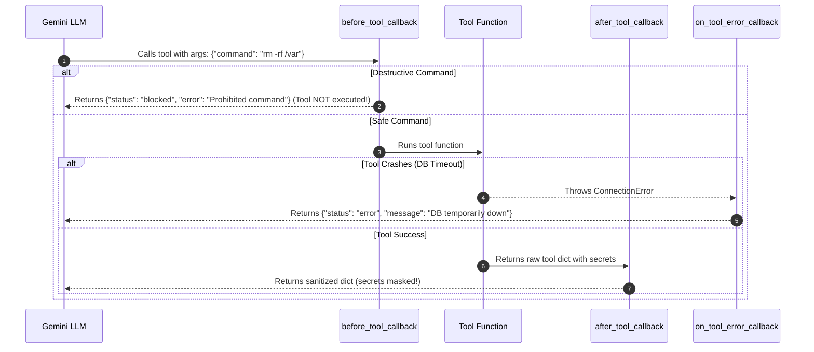

> 📁 **Source Code**: [`callback_agent/`](../callback_agent/)  
> 📖 **Callbacks Master Series**: [Blog Directory](README.md)  
> 🌐 **Official Spec**: [adk.dev/callbacks](https://adk.dev/callbacks/)

---

# Part 3: Tool Execution Callbacks - The Safety Valve for Real Actions

📁 **Code**: [callback_agent/agent.py](../callback_agent/agent.py)  
> **TL;DR**: Intercept tool invocations using `before_tool_callback`, `after_tool_callback`, and `on_tool_error_callback`. Implement destructive command blocking (`rm -rf`), credential masking, the "Store-and-Slim" pattern, and graceful crash recovery.

*Welcome back! In [Part 2](callbacks-part-2-model-interaction.md), we learned how to intercept Gemini's brain for caching and PII redaction.*

---

## Reflections on Part 2

In Part 2, we saw how `before_model_callback` and `after_model_callback` give us complete control over LLM payloads. We slashed token costs with a local cache and ensured credit card numbers never leak.

Now things get serious: giving agents **hands to take real actions in the world**.

---

## What We're Building in Part 3

Earlier in our cookbook series (Parts 5 & 6), we equipped our agents with `FunctionTool` to run actual Python code, query databases, and execute terminal commands.

That power is exciting, but terrifying:
- What if a user tricks the LLM into running `rm -rf /` or `DROP TABLE users`?
- What if a database tool returns sensitive internal credentials (`internal_api_secret`, `db_password`) that the LLM might hallucinate back into the user chat?
- What if the database server times out? Does the whole conversation crash with an unhandled Python exception?

In this part, we build a **Safety Valve** using **Tool Execution Callbacks**:
- `before_tool_callback` - Validating arguments and blocking destructive operations
- `after_tool_callback` - Masking secrets and saving heavy payloads to session state
- `on_tool_error_callback` - Catching tool crashes so the agent can recover gracefully

Let's dive in!

---

## How Tool Callbacks Work

Tool execution callbacks wrap every tool call requested by the LLM:



### The Key Contracts:
1. `before_tool_callback(tool, args, tool_context)`:
   - Returning `None` lets the tool run normally.
   - Returning a `dict` **skips tool execution entirely**! The dictionary is fed directly to the LLM as the tool result.
2. `after_tool_callback(tool, args, tool_context, tool_response)`:
   - Returning `None` keeps the tool response as-is.
   - Returning a `dict` **overrides** what the LLM receives.
3. `on_tool_error_callback(tool, args, tool_context, error)`:
   - Returning a `dict` catches the exception and gives the LLM a structured error report.

---

## Enter: The Safe DevOps Tool Agent

### The Scenario

Imagine our agent has two tools:
1. `execute_server_command(command: str)`: Runs shell commands on an infrastructure server.
2. `lookup_customer_account(account_id: str)`: Queries customer accounts from a backend database.

We want an agent that:
- **Blocks destructive bash commands**: If `command` contains `rm -rf`, `DROP TABLE`, or `mkfs`, block it immediately.
- **Masks internal API secrets**: Mask `internal_api_secret` to `[REDACTED_SECRET]` before Gemini sees it.
- **Catches database timeouts**: If the database throws `ConnectionError`, recover smoothly.

### The Code

```python
from typing import Any, Dict, Optional
from google.adk.agents import Agent
from google.adk.tools import BaseTool, ToolContext

# 1. Tools
def execute_server_command(command: str) -> Dict[str, Any]:
    """Executes a system shell command."""
    return {"status": "success", "stdout": f"Executed command: '{command}'"}

def lookup_customer_account(account_id: str) -> Dict[str, Any]:
    """Fetches customer record from database."""
    if account_id == "corrupt_acc":
        raise ConnectionError("Backend database connection timed out after 3000ms")
    return {
        "account_id": account_id,
        "name": "Alice Johnson",
        "balance": 14250.75,
        "internal_api_secret": "sk_live_super_secret_99882233",
    }


# 2. Tool Callbacks
def command_guard_callback(
    tool: BaseTool, 
    args: Dict[str, Any], 
    tool_context: ToolContext
) -> Optional[Dict[str, Any]]:
    """
    Tool Hook: before_tool_callback
    Runs BEFORE any tool executes.
    """
    print(f"🛠️ [before_tool] Checking tool '{tool.name}' with args: {args}")
    
    if tool.name == "execute_server_command":
        cmd = args.get("command", "").lower()
        blocked_keywords = ["rm -rf", "drop table", "mkfs", "delete from"]
        for bad_pattern in blocked_keywords:
            if bad_pattern in cmd:
                print(f"🛑 [Tool Guard Blocked] Found prohibited keyword: '{bad_pattern}'")
                # Returning a dict SKIPS tool execution and returns this result to LLM!
                return {
                    "status": "blocked",
                    "error": f"Security Policy Violation: Command contains '{bad_pattern}'. Execution blocked."
                }
                
    return None


def secret_scrubber_and_slimmer(
    tool: BaseTool, 
    args: Dict[str, Any], 
    tool_context: ToolContext, 
    tool_response: Dict[str, Any]
) -> Optional[Dict[str, Any]]:
    """
    Tool Hook: after_tool_callback
    Runs AFTER tool returns, before result is sent to LLM.
    """
    print(f"🧼 [after_tool] Scrubbing tool '{tool.name}' response...")
    if isinstance(tool_response, dict):
        sanitized = dict(tool_response)
        
        # 1. Mask internal secrets
        if "internal_api_secret" in sanitized:
            sanitized["internal_api_secret"] = "[REDACTED_SECRET]"
            
        # 2. Store-and-Slim Pattern: Save heavy data to session state!
        if "name" in sanitized:
            tool_context.state["last_customer_name"] = sanitized["name"]
            
        return sanitized
        
    return None


def tool_error_recovery(
    tool: BaseTool, 
    args: Dict[str, Any], 
    tool_context: ToolContext, 
    error: Exception
) -> Optional[Dict[str, Any]]:
    """
    Tool Hook: on_tool_error_callback
    Runs when a tool throws an unhandled exception.
    """
    print(f"🩹 [on_tool_error] Tool '{tool.name}' threw exception: {error}")
    # Return structured error dict so LLM can explain problem smoothly
    return {
        "status": "error",
        "message": f"Service '{tool.name}' is temporarily unavailable. Please retry in a moment."
    }


root_agent = Agent(
    name="safe_devops_tool_agent",
    model="gemini-2.0-flash",
    instruction="You are a safe DevOps assistant. Use tools to inspect accounts and run commands.",
    tools=[execute_server_command, lookup_customer_account],
    before_tool_callback=command_guard_callback,
    after_tool_callback=secret_scrubber_and_slimmer,
    on_tool_error_callback=tool_error_recovery,
)
```

---

## Parameter Breakdown

| Callback Field | Python Signature | When Does It Run? | Return Value Effect |
| :--- | :--- | :--- | :--- |
| `before_tool_callback` | `(tool: BaseTool, args: dict, tool_context: ToolContext)` | Before tool function executes | • `None`: Tool executes normally.<br>• `dict`: **Skips tool execution!** |
| `after_tool_callback` | `(tool: BaseTool, args: dict, tool_context: ToolContext, tool_response: dict)` | Immediately after tool finishes | • `None`: Preserves original result.<br>• `dict`: **Overrides** tool result. |
| `on_tool_error_callback` | `(tool: BaseTool, args: dict, tool_context: ToolContext, error: Exception)` | When a tool raises an unhandled exception | • `None`: Re-raises exception.<br>• `dict`: Suppresses crash, returns structured error. |

---

## What I Learned

- **The Store-and-Slim Pattern**: If your database returns a massive 500-line JSON payload, don't dump the whole thing into the LLM context window! In `after_tool_callback`, save the raw data into `tool_context.state["heavy_data"]`, trim the dictionary down to 5 key fields, and return the slimmed dict to the LLM. Massive token savings!
- **Crash Immunity**: Without `on_tool_error_callback`, any database timeout crashes your entire Python process. With it, the agent politely apologizes and asks the user to retry.
- **Strict Keyword Naming**: Parameter names for tool callbacks must be named `tool`, `args`, `tool_context`, and `tool_response`.

---

## Try It Out

In your terminal running `python run_agent.py`:

### Test 1: Block Destructive Commands
Type `4` (or `danger`).

**Output**:
```text
▶ [TESTING: before_tool_callback]
🛠️ [Tool Hook: before_tool] Validating call to 'execute_server_command' with args: {'command': 'rm -rf /var/data'}
🛑 [Tool Guard Blocked] Dangerous pattern 'rm -rf' detected in command!

[safe_devops_tool_agent]:
Security Policy Violation: Command contains prohibited keyword 'rm -rf'. Execution halted.
```
*(Notice: The terminal command was completely blocked!)*

### Test 2: Mask Database Secrets
Type `5` (or `secret`).

**Output**:
```text
▶ [TESTING: after_tool_callback]
🛠️ [Tool Hook: before_tool] Validating call to 'lookup_customer_account'
🧼 [Tool Hook: after_tool] Sanitizing output from tool: 'lookup_customer_account'

[safe_devops_tool_agent]:
Account ACC-101 belongs to Alice Johnson with balance $14,250.75. 
(API Key: [REDACTED_SECRET])
```

### Test 3: Recover from Tool Crash
Type `6` (or `crash`).

**Output**:
```text
▶ [TESTING: on_tool_error_callback]
🩹 [Tool Hook: on_tool_error] Tool 'lookup_customer_account' threw exception: Backend database connection timed out...

[safe_devops_tool_agent]:
I'm sorry, but the account lookup service is currently unavailable due to a connection timeout. Please try again shortly.
```

Now we have mastered all three levels of callbacks! But how do we wire them together in a production enterprise pipeline?

In **Part 4**, we explore **Callback Chaining, Precedence, and Plugins**!

---

<div align="between">
  <span>[← Previous: Part 2: Model Interaction Callbacks](callbacks-part-2-model-interaction.md)</span> | <span>[Next: Part 4: The Enterprise Pipeline →](callbacks-part-4-enterprise-pipeline.md)</span>
</div>
