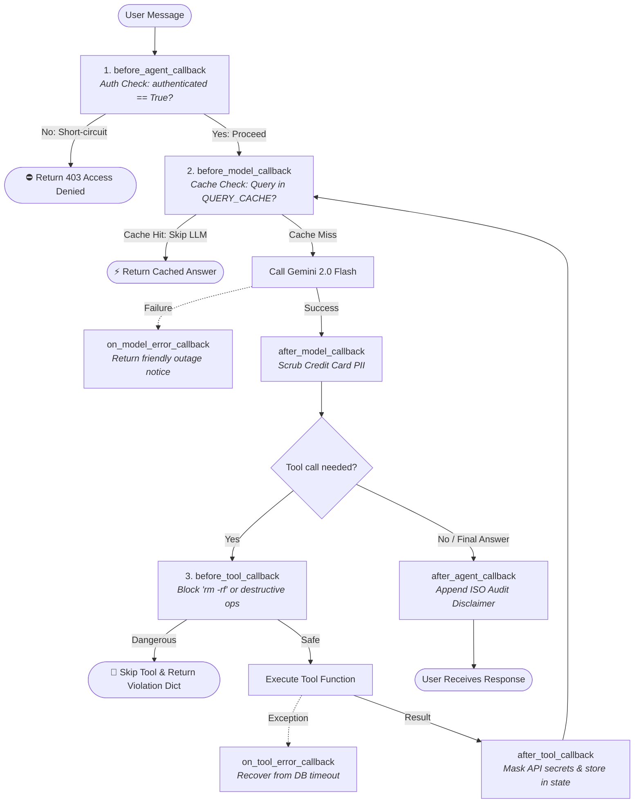

# 🛡️ Enterprise Callback Agent

A production-ready Google ADK agent demonstrating the **Callbacks System** based on the official [Google ADK Callbacks Specification](https://adk.dev/callbacks/).

---

## 🌟 What Does This Agent Do?

While instructions and prompts provide soft behavioral guidance to an LLM, **callbacks provide deterministic, code-level control**. 

This agent demonstrates how to intercept, inspect, validate, modify, and short-circuit execution across the 3 critical boundaries of the ADK runtime:

1. **Agent Lifecycle**: Gatekeeps access via session authentication (`before_agent_callback`) and appends compliance audit notices (`after_agent_callback`).
2. **Model Interaction**: Slashes latency and token costs via in-memory query caching (`before_model_callback`), redacts credit card PII (`after_model_callback`), and handles model outages gracefully (`on_model_error_callback`).
3. **Tool Execution**: Blocks destructive shell commands (`before_tool_callback`), scrubs internal secrets and slims heavy payloads (`after_tool_callback`), and catches backend database crashes (`on_tool_error_callback`).

---

## 📐 Architecture & Execution Flow



---

## 🛠️ Google ADK Features Used

### 1. Agent Lifecycle Callbacks (`BaseAgent`)
Available on all agents (`Agent`, `SequentialAgent`, `ParallelAgent`, `LoopAgent`):
- `before_agent_callback(callback_context)`: Intercepts the request before any agent work starts. Returning `types.Content` halts execution and sends that content directly to the user.
- `after_agent_callback(callback_context)`: Appends final data (disclaimers, surveys) to the conversation history after the agent completes.

### 2. Model Interaction Callbacks (`LlmAgent`)
Available on LLM-powered agents:
- `before_model_callback(callback_context, llm_request)`: Intercepts the request right before the LLM call. Returning `LlmResponse` skips the LLM entirely (ideal for caching or mock testing).
- `after_model_callback(callback_context, llm_response)`: Intercepts raw model output to redact sensitive data or enforce structured output.
- `on_model_error_callback(callback_context, llm_request, error)`: Catches model API exceptions (e.g. quota limits, timeouts).

### 3. Tool Execution Callbacks (`LlmAgent`)
- `before_tool_callback(tool, args, tool_context)`: Inspects tool arguments before execution. Returning a `dict` cancels tool execution and feeds the dictionary directly to the LLM.
- `after_tool_callback(tool, args, tool_context, tool_response)`: Modifies tool results, redacts secrets, or executes the store-and-slim pattern.
- `on_tool_error_callback(tool, args, tool_context, error)`: Recovers from tool runtime exceptions.

---

## ⚠️ The #1 Python Rule from `adk.dev/callbacks`

> [!CAUTION]
> **Exact Parameter Naming is Strictly Enforced!**
> In Python, ADK passes callback arguments by keyword (`**kwargs`). Your callback function arguments **must match** the documented names exactly:
> - For Agent & Model callbacks: `callback_context` (NOT `ctx` or `context`)
> - For Tool callbacks: `tool`, `args`, `tool_context` (NOT `ctx`)
> 
> Using aliases like `def my_callback(ctx):` will result in a runtime `TypeError`!

---

## 🎮 How to Run and Test

### 1. Configure Authentication
Create a `.env` file in this directory or in the workspace root:

```env
GOOGLE_GENAI_USE_ENTERPRISE=FALSE
GOOGLE_API_KEY=your_api_key_here
```

### 2. Run the Interactive Test Console
We built a custom runner that lets you toggle states, test cache hits, trigger command blocks, and see errors handled live:

```bash
cd callback_agent
python run_agent.py
```

### Try these interactive commands:
- Type **`login`** -> Sets session state `authenticated = True`.
- Type **`logout`** -> Sets session state `authenticated = False` (observe `before_agent_callback` block requests).
- Type **`hours`** -> Triggers an instant in-memory cache hit via `before_model_callback` without calling Gemini.
- Type **`danger`** -> Asks the agent to run `rm -rf /var/data` (observe `before_tool_callback` block the command).
- Type **`account`** -> Asks the agent to fetch `ACC-101` (observe `after_tool_callback` scrub the API secret).
- Type **`crash`** -> Asks the agent to fetch `corrupt_acc` (observe `on_tool_error_callback` recover from the database crash).

### 3. Run with ADK Web UI
```bash
adk web
```
Select `enterprise_callback_agent` from the dropdown to chat visually!

